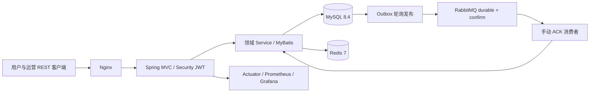

# 整体架构设计 V1

日期：2026-10-28。项目从零实现；当前工作区无酒店后端源码，旧复盘文档不作为已有实现证据。所有新增代码均为个人重构。

## 架构

Java 21 + Spring Boot 3.5.16；MyBatis Starter 3.0.5（官方 3.0.x 支持 Boot 3.2–3.5）。Springdoc 2.8.x 对应 Boot 3.5。Spring Security、AMQP、Data Redis、Flyway、MySQL Connector 和 Micrometer 由 Boot BOM 管理，避免手工覆盖传递依赖。测试固定 Testcontainers 1.21.3；具体解析结果由 Maven dependency tree 生成。

依据：[Boot](https://docs.spring.io/spring-boot/3.5/system-requirements.html)、[MyBatis](https://github.com/mybatis/spring-boot-starter)、[Springdoc](https://springdoc.org/#what-is-the-compatibility-matrix-of-springdoc-openapi-with-spring-boot)。版本兼容声明不能替代启动测试。

## 核心原则
模块化单体：一次部署、同一数据库、本地 ACID 事务。不声称 Compose 是高可用集群。MySQL 为房型日期库存、活动配额和订单的最终权威。Redis 秒杀扣减仅是准入。报价有有效期，订单逐晚保存金额快照，金额统一 CNY / DECIMAL(12,2) / BigDecimal。

库存不变量：`total = available + held + sold + blocked`；各项非负。blocked 表示维修停用占用，sale_status 是销售开关，关闭不改变已有订单。减房量不得侵占 held/sold；增加房量增加 available；入住/退房不再释放已消费的 sold。离店日不占库存。实体房间只承载房号及保洁维修状态，不作为线上库存行。

## 可靠性与边界
普通预订在 Redis/MQ 失效时仍依赖 MySQL 正确执行；秒杀 Redis 不可用则 503。Outbox 将业务与事件在同一事务提交；MQ 至少一次。事件 ID 唯一 + 消费记录与业务同事务保证效果幂等。外部网络调用不放入库存事务。支付与关闭统一先锁订单，同一事务做状态和库存转换。数据库采用 READ COMMITTED，库存按日期升序获取锁，死锁在事务外有限重试。

## 容量与安全
连接池有界，MVC 线程池有界，MQ prefetch 有界，JWT 过期/issuer/签名均校验；密码 BCrypt。USER、HOTEL_MANAGER、ADMIN 三角色；酒店授权表控制管理边界，用户订单查询校验 user_id。生产 secret 必须外置，演示身份仅在显式 demo profile 初始化。API 错误不输出 SQL、密码、token。监控端口不由公网 Nginx 暴露。

## 迭代规则
先完成 Phase 1 真实 MySQL 启动、迁移、认证、资源归属和日历测试，验证通过后推进交易、缓存、消息、秒杀。每阶段状态以 docs/verification.md 为准，未运行的压测不得填充推测数字。
