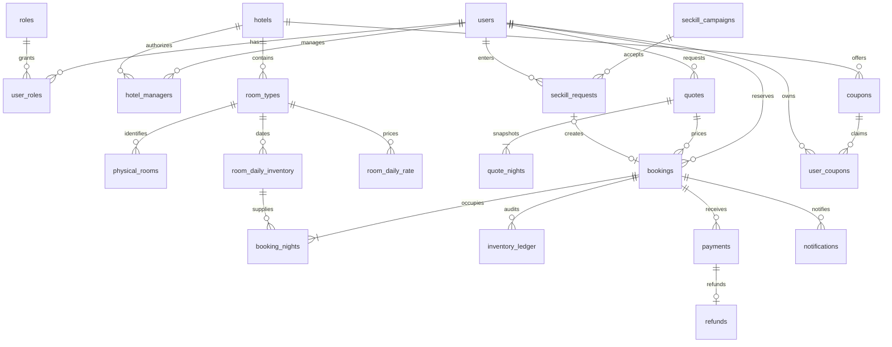

# 数据库 ER 图、DDL 与核心索引设计

权威完整 DDL：`src/main/resources/db/migration/V1__schema.sql`，由 Flyway 自动执行。没有破坏性迁移。所有业务ID BIGINT；报价/消息/请求UUID；日期 DATE；审计/到期 UTC DATETIME(6)；金额 DECIMAL(12,2) CNY，不用浮点。



Outbox、processed_messages、audit_logs 是技术/审计实体；outbox aggregate_id 为多态业务引用，不设置跨聚合外键，避免删除策略和多种事件耦合。其生命周期需保留直至投递与审计窗口结束。

| 表 | 字段/约束/用途 |
|---|---|
| users/roles/user_roles | email唯一，密码哈希；联合主键防重复角色 |
| hotels/hotel_managers | city/status检索索引，授权联合主键；时区用于入住规则 |
| room_types/physical_rooms | hotel/status/capacity/price过滤；房型+房号唯一；room_count只是物理配置参考 |
| room_daily_inventory | (room_type_id,stay_date)聚簇主键，逐晚精确锁；total/available/held/sold/blocked CHECK；sale_status独立开关 |
| room_daily_rate/quote_nights | 日期复合主键，订单使用报价快照而非后续变价 |
| quotes | user_id归属、expires_at有效期；不承诺报价锁库存 |
| bookings | (user_id,client_request_id)唯一；fingerprint检查同键异义；(status,expires_at,id)扫描超时；(hotel_id,check_in,status)运营查询 |
| booking_nights | 每晚unit_price、quantity；FK指向确切日期库存；(room_type_id,stay_date,booking_id)对账 |
| inventory_ledger | (booking_id,stay_date,operation)唯一防重复业务流水；允许无订单的ADJUST |
| payments/refunds | provider_ref唯一防重复资金事件；refund payment_id唯一；状态与订单独立 |
| coupons/user_coupons | quota/claimed条件更新；(user_id,coupon_id)唯一；订单锁定关联 |
| seckill_campaigns/requests | quota/quota_used活动额度；(campaign_id,user_id)唯一，结果持久化 |
| outbox_events | (status,next_attempt,id)有界轮询，SENT保留证据、DEAD待重放 |
| processed_messages/notifications | eventId唯一；与消费者效果同事务 |
| audit_logs | actor/action/time索引；不存请求原文或敏感字段 |

## SQL 与执行计划
```sql
EXPLAIN SELECT * FROM room_daily_inventory WHERE room_type_id=1 AND stay_date>='2026-11-01' AND stay_date<'2026-11-04' ORDER BY stay_date;
EXPLAIN SELECT id FROM bookings WHERE status='PENDING_PAYMENT' AND expires_at<=UTC_TIMESTAMP(6) ORDER BY expires_at,id LIMIT 100;
EXPLAIN SELECT id FROM outbox_events WHERE status='NEW' AND next_attempt<=UTC_TIMESTAMP(6) ORDER BY next_attempt,id LIMIT 20;
UPDATE room_daily_inventory SET available=available-1,held=held+1,version=version+1 WHERE room_type_id=1 AND stay_date='2026-11-01' AND available>=1 AND sale_status='OPEN';
```

预期库存走 PRIMARY range，超时走 ix_booking_expiry，outbox走ix_outbox_pending；这只是设计预期，实际 EXPLAIN 输出由集成测试写入 `target/explain.txt`，不伪造 rows/cost。小数据集优化器可能选全扫，不能仅以是否用索引判定优化成功。

跨日期必须同事务，因为最后一晚不足时要回滚先前各晚；逐晚独立提交会形成无法履约的残留锁房。历史日期仍保留sold作为已消费间夜记录，不能退房时增加历史可售量。大报表按日期范围与hotel过滤，后续规模增长再考虑汇总表，不在初始阶段分库。
